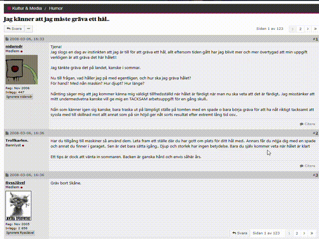

# Kattskrälle – Flashback Forum quality of life plugin

---

## Svenska / Swedish
### Om
Kattskrälle är ett webbläsartillägg som gör Flashback-forum lite trevligare och enklare att använda.  

### Funktioner
- 🚫 **Ignorera användare** – döljer inlägg från valfria användare. (Nu även möjligt för inlägg som citerar användaren)
- 🔄 **Infinite scroll** – ladda in nya sidor automatiskt utan att behöva klicka dig vidare.
- 🔍 **Sök länkar** – leta igenom en tråd efter alla länkar och spara resultatet som .txt eller .html-filer.
- 💬 **Trådchatt** – konverterar trådar till chattfönster med realtidsuppdatering, möjlighet att svara direkt i chatten och få ljudnotifikation vid nya inlägg.
- ↪️ **Hoppa över bekräftelsesidor** – slipp mellanliggande bekräftelsesidor när du öppnar externa länkar.  
- 🌟 **Visa Trådskapare (TS)** – markerar trådskaparens inlägg med ljusgul bakgrund.  
- ✅ **Markera Visade Trådar**– lägger en bakgrundsfärg på redan lästa trådar.
- 💾 **Spara & ladda utkast** – spara pågående inlägg eller trådar och fortsätt skriva senare.
- 🖼️ **Förhandsvisa innehåll** – bädda in media direkt i tråden:  
  - Bilder och videofiler från vissa bildlänkar  
  - YouTube-videor  
  - Spotify-länkar  
[Se Screenshots](#screenshots)

### Installation  
**Alternativ A – Chrome Web Store**  
-Installera tillägget direkt genom [Chrome Web Store](https://chromewebstore.google.com/detail/kattskr%C3%A4lle/fjpkphodnakdkehikggcfmfpbcbblhlc).  

**Alternativ B – Installera manuellt**  
1. Ladda ner projektet som ZIP eller klona repo:t.  
2. Öppna Chrome (eller annan Chromium-baserad webbläsare) och gå till `chrome://extensions/`.  
3. Aktivera **Developer mode** (Utvecklarläge).  
4. Klicka på **Load unpacked** och välj mappen med tillägget.  
5. Tillägget aktiveras och fungerar direkt på [Flashback.org](https://www.flashback.org/). 


### Status
Projektet är under utveckling och fler funktioner kan tillkomma.  
Feedback och förslag på förbättringar är alltid välkomna!  

### Disclaimer
Det här projektet är ett **fristående tredjeparts-tillägg** och har **ingen koppling** till Flashback Forum eller Flashback Media Group.  
Alla varumärken, logotyper och namn som nämns tillhör respektive ägare.  

### Licens
Detta projekt är licensierat under **GNU General Public License v3.0 (GPLv3)**.  
Du får använda, modifiera och distribuera koden fritt, **så länge du också delar din version under samma licens**.  
Se [LICENSE](LICENSE) för fullständig text.

---

## English

### About
Kattskrälle is a Chrome extension that makes the Flashback forum a bit more pleasant and convenient to use.  

### Features
- 🚫 **Ignore Users** – hides posts from selected users. (Now also works for posts quoting the user)
- 🔄 **Infinite scroll** – automatically load new pages without clicking through.
- 🔍 **Find links** – scan a thread for all links and save the results to .txt or .html files.
- 💬 **Thread Chat** – converts threads into chat windows with real-time updates, allows writing replies directly in the chat, and provides sound notifications for new posts.
- ↪️ **Bypass confirmation sites** – skip intermediate confirmation pages when opening external links.
- 🌟 **Show Thread Starter (TS)** – highlights the thread starter’s posts with a light yellow background.  
- ✅ **Mark Viewed Threads** – adds a background color to threads you’ve already visited.
- 💾 **Save & Load Drafts** – save your ongoing posts or threads and continue writing later.
- 🖼️ **previews** – embed media directly in threads:  
  - Images and videos from supported hosts  
  - YouTube videos  
  - Spotify links
  [See Screenshots](#screenshots)

### Installation  
**Option A – Chrome Web Store**  
-Install the extension directly from the [Chrome Web Store](https://chromewebstore.google.com/detail/kattskr%C3%A4lle/fjpkphodnakdkehikggcfmfpbcbblhlc).  

**Option B – Manual Installation**  
- Download the project as a ZIP or clone the repo.  
- Open Chrome (or another Chromium-based browser) and go to `chrome://extensions/`.  
- Enable **Developer mode**.  
- Click **Load unpacked** and select the folder containing the extension.  
- The extension is now active and works on [Flashback.org](https://www.flashback.org/).  


### Status
The project is under development and more features may be added.  
Feedback and suggestions are always welcome!  

### Disclaimer
This project is an **independent third-party extension** and is **not affiliated with** Flashback Forum or Flashback Media Group.  
All trademarks, logos, and names mentioned belong to their respective owners.  

### License
This project is licensed under the **GNU General Public License v3.0 (GPLv3)**.  
You may use, modify, and distribute the code freely, **as long as you share your version under the same license**.  

See [LICENSE](LICENSE) for the full text.

## Screenshots
 
 




---

## Kodstruktur / Code structure

Tillägget är uppdelat i moduler – en fil per funktion som kan slås av/på i inställningarna. Filerna laddas i den ordning de står i `manifest.json` (de delar samma globala scope, `core/bootstrap.js` laddas sist).  
The extension is split into modules - one file per feature that can be toggled in the settings. Files are loaded in the order listed in `manifest.json` (they share one global scope; `core/bootstrap.js` is loaded last).

```
src/
  core/
    settings.js              Settings flags, defaults, loading of saved settings
    state.js                 Shared state (current thread id)
    functions-div.js         Shared "Kattskrälle extension" button row
    find-posts.js            Runs the per-post features over the posts on the page
    bootstrap.js             main(), re-init and page level listeners (entry point)
  features/
    ignore.js                Ignorera + Ignorera även i citat (placeholder for hidden posts)
    previews.js              Previews
    bypass-leaving-site.js   Bypass Leaving Site
    infinite-scroll.js       Infinite Scroll
    multi-quote-fix.js       Multi-quote (Citera+) support for Infinite Scroll
    thread-tracking.js       Visa Trådskapare (TS) + Markera visade trådar
    drafts.js                Spara & ladda utkast
    search-links.js          Sök länkar
    thread-chat.js           Trådchatt
```
